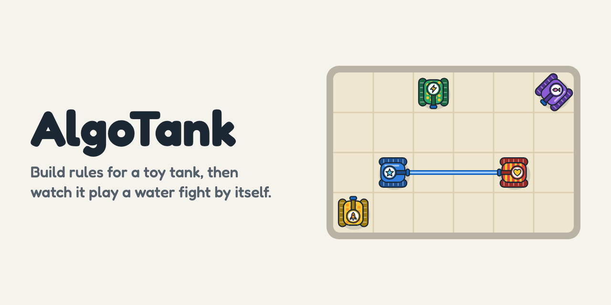
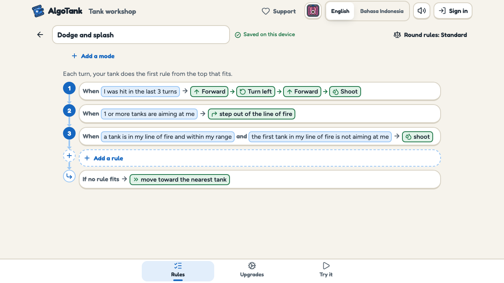
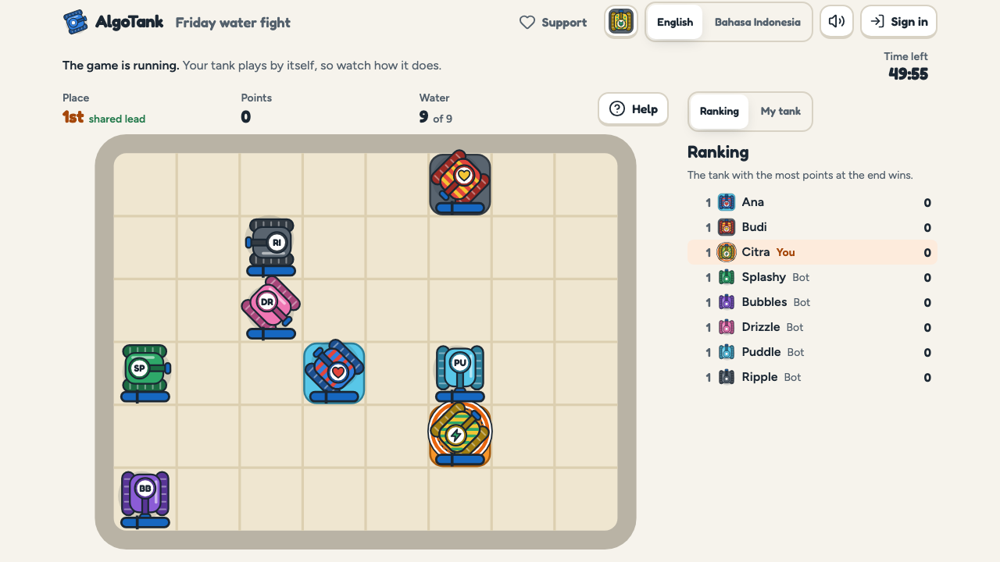
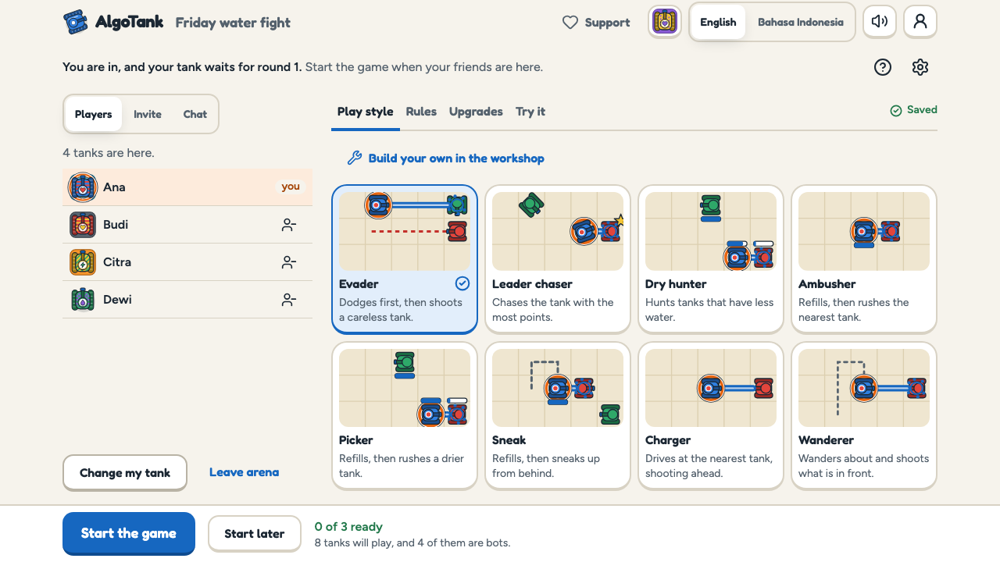
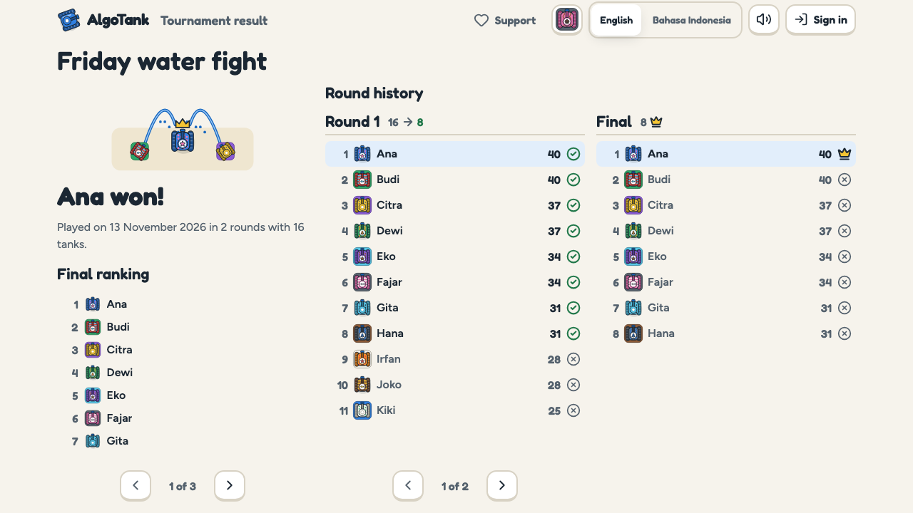

<p align="center"></p>

# AlgoTank

AlgoTank is a water fight game in the browser for people who do not program, children of about 10 included. Each player builds rules for a toy tank ("When [something is true] → [do this]"), which is an algorithm, and then watches the tank play by itself against the other tanks.

The interface is in English and Indonesian. It starts in Indonesian, and every page has a language switch.

| | |
|---|---|
|  |  |
|  |  |

## How to play

1. Open the game and press "Play now", or type the 6-character code that a friend shared.
2. Pick a play style for your tank, or build your own rules. Each turn, the tank does the first rule from the top that fits.
3. Spend your upgrade points on Range, Aim and Dodge.
4. Watch the round. Nobody steers. A hit moves 1 point from the tank that was hit to the shooter, and a shot uses water that refills over time.
5. With more than 8 tanks, each round keeps the top half until 8 remain, and one final decides the winner.

## What is in the box

| Part | What it does |
|------|--------------|
| Practice arena | "Play now" for anyone, with no sign-in. Bots fill the empty seats, and a new game starts every few minutes. This is also how one person plays alone against bots. |
| Tournament arena | A public knockout of up to 64 people that starts again and again. The last 50 tournaments that a person won are on `/champions`. |
| Monthly league | One round per calendar day. A signed-in account seats one tank, which plays every day until its owner quits. At each month's end half of each league moves up or down, and the month's champion is kept for good. |
| Private arena | An account creates it for a friend group, sets the number of tanks, and plays too. Bots can fill the free seats. "Play again" starts a new game with the same people. |
| Presenter arena | An account creates it for an event with up to 512 players, who join by QR code. The organiser shows a big screen and does not play. |
| Organiser tournament | In a private or presenter arena, the organiser decides when each round starts, can admit only signed-in players, and keeps the result and its round history for 180 days. |
| Chat | Players and the owner of a private or presenter arena chat between rounds. |
| Accounts | Email and password. With mail settings, the server sends 6-digit codes to verify an email and to reset a password. |
| Tank workshop | Players build and keep their own play styles, and keep one tank name and look as "My tank". |
| Statistics | After each round a player sees what their own tank and rules did. A signed-in player's games, wins, rounds, shots and hits add up on the "My tank" page. |
| Sound | Synthesised sound effects and one background music track, each with its own switch. |
| Usage numbers | The server counts each day's visitors, games and sign-ups, with no address or name, for the accounts in `ADMIN_EMAILS` on `/admin/metrics`. `GET /metrics` gives a monitor the server's health. |

`docs/arenas.md` has the numbers for each kind of arena.

## Quickstart

You need Bun 1.4 or later (`https://bun.sh`).

```sh
bun install
bun run build    # builds the web client into apps/web/dist
bun run start    # serves the API and the client on port 8787
```

Open `http://localhost:8787/`. Press "Play now", or create an account and then a private or presenter arena.

The room and presenter pages build the player link from the address in the browser. For players on other devices, open the site by an address they can reach (for example `http://192.168.1.20:8787/`), not by `localhost`.

For development, run the two parts in two terminals:

```sh
bun run dev:server   # API on 8787, restarts on change, data in apps/server/data
bun run dev:web      # client on 5183, sends /api to 8787
```

These settings matter most. `docs/settings.md` lists all of them.

| Variable | Meaning | Default |
|----------|---------|---------|
| `PORT`, `HOST` | Where the server listens | 8787, every interface |
| `DATA_DIR` | The folder of the SQLite database, which holds accounts, arenas, results, chat and the league | `./data` |
| `COOKIE_SECURE` | `1` sends the sign-in cookie over HTTPS only | off |
| `TRUST_PROXY` | `1` reads the client address from `X-Forwarded-For`, behind a proxy that sets it | off |
| `SMTP_HOST`, `SMTP_PORT`, `SMTP_USER`, `SMTP_PASS`, `MAIL_FROM` | The mail server for the email codes. Without `SMTP_HOST` the server sends no email. | not set |

## Project layout

The repository is a Bun workspace with TypeScript in strict mode.

| Folder | Holds |
|--------|-------|
| `packages/engine` | The rules of play, pure and deterministic. `combat/rule-sets.ts` has every number of every rule set, `round/` resolves turns, and `strategy/` has the vocabulary tables, the validator and the play styles. |
| `packages/arena` | The arena state machine, the arena kinds, bots and tank looks, and the messages between server and browser. `src/types.ts` is the contract and lists every route. |
| `apps/server` | The Bun HTTP server: routes, accounts (`auth/`), the turn timer, the event stream, replays, the database (`db/`), public arenas, the monthly league (`monthly/`), chat, stored results, statistics (`stats/`) and usage numbers (`metrics/`). |
| `apps/web` | The React 19 client, built with Vite 8 and Tailwind 4, with one folder per feature under `src/`. |
| `deploy` | The production files for an Ubuntu server. `docs/deployment/` explains them. |

| `apps/web/src/` folder | Holds |
|------------------------|-------|
| `app`, `i18n`, `ui`, `kit` | Routes and navigation, the language store and the message catalogs, shared components and tokens, and the `/kit` gallery |
| `home`, `publicplay`, `auth`, `create` | The home page and `/join`, the "Play now" chooser, sign-in and accounts, and the create pages |
| `room`, `player`, `host`, `screen` | The arena room for players, the presenter page and the big screen |
| `prep`, `editor`, `practice`, `vocabulary`, `rules`, `workshop`, `mytank` | Preparing a tank: play styles, upgrades, the rule editor, the test match, the words for the engine's vocabulary, the round rules, the tank workshop and "My tank" |
| `board`, `live`, `standings`, `results`, `tank`, `water` | The board and its motion, a running round, rankings, results, the tank drawing and the water gauge |
| `monthly`, `champions`, `chat`, `guide` | The monthly league page, `/champions`, the arena chat, and the tours for first-time players |
| `stats`, `metrics` | The statistics card and the account's totals, and the usage numbers on `/admin/metrics` |
| `stream`, `api`, `session`, `share`, `sound`, `support` | The event stream, API calls and error sentences, what the browser keeps per arena, the QR code and share panel, the sound effects and the music, and the "Support" modal |

Each feature folder keeps its own interface text in `messages.ts`, in English and Indonesian. `i18n/catalog.ts` joins them.

## Scripts

| Command | Does |
|---------|------|
| `bun run dev:server` | Starts the API on port 8787 and restarts it on change |
| `bun run dev:web` | Starts the Vite client on port 5183 |
| `bun run build` | Builds the web client into `apps/web/dist` |
| `bun run start` | Starts the server, which also serves the built client |
| `bun test` | Runs the unit, component and server tests |
| `bun run type-check` | Type-checks the four packages, which also checks that the Indonesian catalog has every English message |
| `bun run complete-check` | Runs the type check, the tests and the build, as CI does |
| `bun run simulate` | Plays 1000 finals of 8 and prints how often each play style wins |
| `bun run backup <target file>` | Writes a copy of the database in `DATA_DIR` to a new file, also while the server runs |
| `bun run audit -- <server> <folder> [screens]`, in `apps/web` | Runs the no-scroll audit (`CONTRIBUTING.md`) |

`docs/tools.md` explains the balance, large-round and load-test scripts.

## Tests and the no-scroll audit

Every change must pass `bun test` and `bun run type-check`. No screen may scroll at the supported sizes (`docs/specs/revamp/60-no-scroll.md`). The audit script `apps/web/scripts/no-scroll-audit.mjs` checks that in a real browser, in both languages. `CONTRIBUTING.md` says how to run it.

## Deployment

The game runs as one Bun process. `docs/deployment/` is the runbook for one Ubuntu server behind Caddy and Cloudflare: the first deploy, the Cloudflare settings, updates and rollback, backups, monitoring, troubleshooting and mail. `deploy/` holds the files it installs. Nothing in it was tested on a real server yet.

On any other host, keep these rules:

1. Build the client with `bun run build` on the machine or in the image.
2. Start exactly one server process with `bun apps/server/src/index.ts`, and give it its own `DATA_DIR`. Start Bun directly, not through `bun run start`, so that `SIGTERM` reaches the server, which then writes the arenas and the league's checkpoint, closes the streams and closes the database.
3. Put an HTTPS proxy in front of it. Set `HOST=127.0.0.1` when the proxy runs on the same machine, and set `COOKIE_SECURE=1`. Set `TRUST_PROXY=1` only when the proxy replaces `X-Forwarded-For` with the visitor's address and sets `X-Forwarded-Host`.
4. Point the health check of the proxy or the monitor at `GET /api/health`.
5. Keep `DATA_DIR` private and back it up with `bun run backup <target file>`. A copy of the folder while the server runs is not a safe backup, because the newest writes can be only in the `-wal` file. The database holds player tokens, password hashes and session hashes.

## Documentation

| File | Holds |
|------|-------|
| `docs/arenas.md` | The kinds of arena and their numbers |
| `docs/settings.md` | Every server setting |
| `docs/routes.md` | The HTTP routes |
| `docs/tools.md` | Balance, large-round and load-test scripts |
| `docs/known-limits.md` | What the game does not do yet |
| `docs/DEBT.md` | Every deliberate shortcut and known limit, with what would clear it |
| `docs/deployment/` | The production runbook |
| `docs/decisions/` | The decision log behind the rules of play |
| `docs/specs/revamp/` | The design record of each work package, starting at `00-overview.md` |
| `PRIVACY.md` | What a server stores and for how long |

The game takes its starting mechanics from [cloudbowl-microservice-game](https://github.com/GoogleCloudPlatform/cloudbowl-microservice-game) (Apache-2.0). It shares no code, name or art with it.

## Contributing

`CONTRIBUTING.md` explains the setup, the checks, and what a pull request needs. Everyone in the project follows `CODE_OF_CONDUCT.md`. Report a vulnerability as `SECURITY.md` says, not in a public issue.

## Support

You can support the work on [GitHub Sponsors](https://github.com/sponsors/snowfluke).

## License

MIT. See `LICENSE`.
